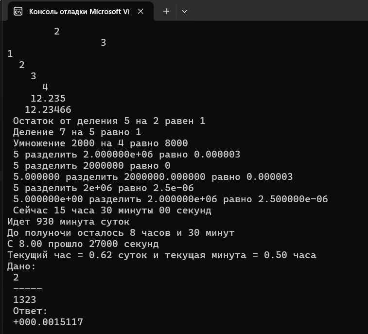

# Лабораторная работа 2

## Цель работы
Получение практических навыков работы с функцией форматированного вывода printf.

## Результаты работы программы

## Информация о разработчике
Орлова Эльвира Эдуардовна
Группа: бИД-261
